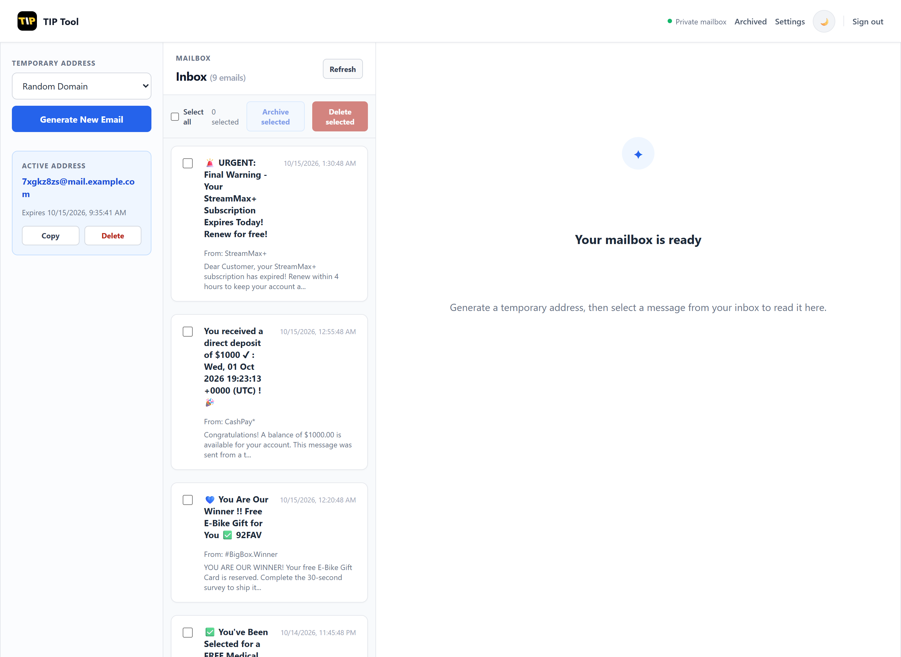
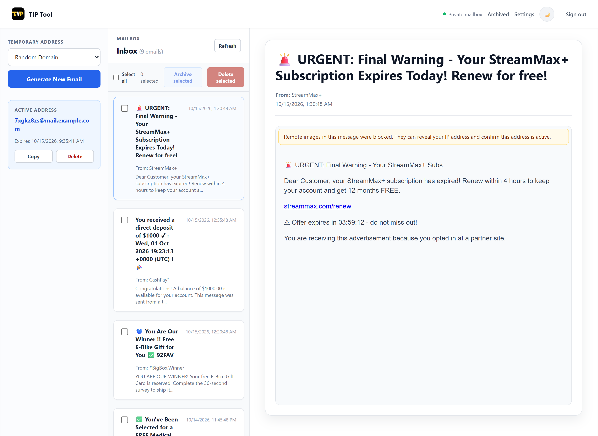

# Temp Identity Privacy (TIP) Tool

**Your own private disposable-email service. One catch-all mailbox, unlimited throwaway addresses, no third party reading your mail.**

[](LICENSE)


[](docs/DOCKER.md)

<p align="center">
  
  
</p>
<p align="center"><em>Junk lands on a throwaway address instead of your real inbox. Left: the inbox. Right: reading a message safely.</em></p>

Every sign-up form, trial, and "download the PDF" gate asks for your email address, and once you hand it over you never get it back. TIP Tool lets you give each of them a fresh, random address on **your own domain** (`x7k2p9@yourdomain.com`) and read the mail in a private inbox you host yourself. Your real address stays out of marketing lists, data breaches, and phishing campaigns.

**Read the write-up:** [Why I Built TIP Tool: A Self-Hosted Way to Stop Handing Out My Real Email Address](https://pritamkhedekar.com/post/why-i-built-tip-tool-a-self-hosted-way-to-stop-handing-out-my-real-email-address), covering the threat model, the research behind it, and a Hostinger walkthrough.

## Why TIP Tool?

| | Typical public disposable-mail sites | **TIP Tool** |
|---|---|---|
| Who can read your mail | The service operator, and anyone who guesses the address | Only you, behind an admin login |
| Where your data lives | Their servers | Your database, on your hosting or your own machine |
| Addresses | Shared public domains that many sites block | Your own domain, so sign-ups are far less likely to be rejected |
| Mailboxes to manage | n/a | **One** catch-all mailbox serves every generated address |
| Cost | Free, but you are the product | Runs on cheap shared hosting or locally on XAMPP/LAMP |
| Code | Varies | MIT-licensed, readable, auditable |

## Features

- **Random addresses on your domain**, with optional domain selection and automatic expiry.
- **Catch-all architecture**: add one IMAP mailbox once; TIP Tool matches each incoming message to the address you generated and shows it in that address's inbox view.
- **Private by design**: single-owner mailbox behind an admin login, `noindex` headers and `robots.txt`, no tracking, no third-party scripts beyond the HTML sanitizer.
- **Safe email viewing**: incoming HTML is sanitized with DOMPurify and rendered in a sandboxed frame that cannot run scripts or submit forms. Remote images (including tracking pixels) are blocked, and the reader tells you when that happened.
- **Link warning**: before a link in a message opens, a dialog shows the real destination and flags look-alike link text, `xn--` domains, credentials embedded in the address, raw IP hosts, and plain `http`.
- **Security built in**: CSRF protection, encrypted IMAP credentials (AES-256-GCM with an HKDF-derived key; older CBC rows stay readable and are upgraded when the domain's password is re-saved in the admin panel), persistent login throttling with account lockout, admin sessions pinned to your network and browser (`SESSION_PIN_IP`: `subnet` by default, `strict`, or `off`), spoof-resistant rate limiting, and a CSP that forbids inline scripts plus security headers.
- **Archive and bulk actions**: keep important messages, delete or archive in bulk, dark mode.
- **One-page setup wizard**: `setup.php` imports the schema, creates your admin account, and writes the config and cron scripts outside the web root.

## Quick start

```bash
git clone https://github.com/protonic/TempIdentityPrivacy-TIP-Tool.git
```

1. Upload the files to your web root (`public_html` on shared hosting, or `htdocs` under XAMPP) and create an **empty** MySQL/MariaDB database.
2. Open `https://yourdomain.com/setup.php`, enter your database details and admin account, and run it. It imports the schema and writes the config for you.
3. **Delete `setup.php`**, sign in at `/admin/login`, and add your catch-all IMAP mailbox under *Manage Domains*.
4. Click *Generate address*, use it anywhere, and watch the mail arrive.

### Or run it with Docker

On a VPS or home server, one command starts the app, a MySQL database, and a background mail fetcher. The setup wizard isn't used: the schema and your first admin account are created from `.env` on first start.

```bash
git clone https://github.com/protonic/TempIdentityPrivacy-TIP-Tool.git
cd TempIdentityPrivacy-TIP-Tool
cp .env.example .env
docker compose up -d
```

Fill in `.env` (database passwords, `CRON_SECRET_KEY`, admin account) before the last command, then open `http://localhost:8080/admin/login`. See [docs/DOCKER.md](docs/DOCKER.md) for HTTPS behind a reverse proxy, upgrades, and backups.

Requirements, a Hostinger walkthrough, IIS notes, and cron setup are covered in the sections below. If you only want privacy for yourself you don't need a public server at all: see [Running This for Personal Identity Privacy](#running-this-for-personal-identity-privacy-no-public-hosting-or-multiple-mailboxes-needed).

## Deployment assumptions

- A `tip-config` folder one level above the web root holds your credentials (the wizard creates it).
- A `tip-cron` folder one level above the web root holds optional cron scripts for server-side fetching.
- At least one IMAP mailbox with catch-all routing is configured in the admin panel.
- Out of the box, mail is fetched while you have the mailbox open, via `includes/handlers/auto_fetch.php`. Use the generated `tip-cron` scripts if you also want mail fetched in the background.

## Contributing and feedback

Issues and pull requests are welcome. See [CONTRIBUTING.md](CONTRIBUTING.md), and report security problems privately as described in [SECURITY.md](SECURITY.md). If TIP Tool is useful to you, a star helps other people find it.

Built by [Pritam Khedekar](https://pritamkhedekar.com).

## Setup Wizard (`setup.php`)

The fastest way to provision a new deployment is the setup wizard at the web root:

```text
https://yourdomain.com/setup.php
```

It is a one-time, self-contained form that:

- Lets you choose the config and cron folder names (defaults: `tip-config` and `tip-cron`). Both are created as siblings of the web root. Custom names are useful when you keep multiple copies of this project (e.g. a `-dev` or `-staging` checkout) under the same parent directory, so one copy's setup run doesn't overwrite another's config.
- Tests your database connection with the credentials you provide before writing anything.
- Imports the database schema (`sql/installer_public_release.sql`) for you. To protect existing data it only does this when the database has none of the TIP Tool tables yet, because that SQL begins with `DROP TABLE IF EXISTS`. If some tables exist but `admin_users` is missing, it stops with an error instead of guessing.
- Creates your first admin account from the form: username, email, and a password with a confirm field, a show/hide eye toggle on both fields, and a live "passwords match" check. The password must be 10–72 characters (72 is bcrypt's limit) and is stored only as a `password_hash()` bcrypt hash. It is never echoed back into the form. If the database already has an admin, this step is skipped automatically (with `?force=1` you can add another admin, but an existing username is rejected).
- Creates `<config-folder>/config.php` and `<config-folder>/database.php` (one level above the web root), populated with your site name, site URL, admin email, DB credentials, a generated `CRON_SECRET_KEY`, and your rate-limit/expiry settings.
- Creates `<cron-folder>/.htaccess` (deny-all), `<cron-folder>/fetch_emails_fixed.php`, and `<cron-folder>/cleanup_emails_fixed.php` — ready-to-schedule command-line scripts for IMAP mail fetch and expired-email cleanup, wired to read from the config folder name you chose.
- Refuses to overwrite an existing `<config-folder>/config.php` unless you explicitly reload it with `?force=1`, so it can't be re-run by accident against a live deployment.

**⚠ Delete `setup.php` from the web root immediately after setup succeeds.** It can write live database credentials and a secret encryption key to disk, so leaving it reachable on a public server is a security risk — the page itself displays this warning, and it is also called out in a comment at the top of the file.

After running it, delete `setup.php`, sign in at `/admin/login`, add your catch-all IMAP domain in `Manage Domains`, and schedule the two generated `tip-cron` scripts (see "Mail Fetching and Cron" below). The schema import and first-admin steps are already done by the wizard, so you can skip steps 3 and 4 of the Manual Setup section.

## Full Feature List

- Private, single-owner mailbox: only the admin account created during setup can sign in and use the mailbox (`/admin/login`, then `/mailbox`). There is no public multi-user account system.
- Disposable email generation with random local parts and optional domain selection.
- Multi-domain support using the `domains` table and admin-managed IMAP credentials.
- Inbox retrieval for active temp addresses with message history stored in MySQL.
- Automatic browser-side mail polling and server-side IMAP fetch via `includes/handlers/auto_fetch.php`.
- HTML and plain-text email viewing with frontend sanitization for safer rendering.
- One-click copy, refresh, and delete actions for generated addresses.
- Automatic expiration support for temporary email addresses.
- Admin login with database-backed sessions, failed-login tracking, and temporary account lockout.
- Admin dashboard with domain management, system statistics, security logs, blocked IPs, and surveillance IP/CIDR management.
- Encrypted storage of IMAP passwords in domain management using `CRON_SECRET_KEY`.
- CSRF protection, secure-cookie session settings, CSP/security headers, IP blocking, hourly/daily rate limiting, and abuse logging.
- SQL installer for core runtime, admin, stats, and security tables.
- Search-indexing controls through `robots.txt`.
- `setup.php` first-run wizard that imports the schema, creates your first admin account, and generates `tip-config` and `tip-cron` (with ready-to-schedule fetch/cleanup scripts) outside the web root.

## How the Project Works

1. The owner signs in at `/admin/login` with the admin account created during setup.
2. Once signed in, `/mailbox` loads the active domains list from the database.
3. A temp address is generated and stored in `temp_emails`.
4. The browser periodically calls `includes/handlers/auto_fetch.php`.
5. That handler connects to each active IMAP domain, fetches unread mail, and stores matching messages in `email_messages`.
6. The inbox UI reads stored messages for the currently selected temp address.

Important inference from the code:
Generated addresses use random local parts such as `abcd1234@yourdomain.com`. That means each configured domain must route those unknown recipients into the IMAP inbox you monitor, usually through a catch-all mailbox or equivalent alias/routing rule from your mail provider.

## Running This for Personal Identity Privacy (No Public Hosting or Multiple Mailboxes Needed)

If your goal is purely personal — keeping your real inbox out of sign-up forms, trials, and downloads — you don't need a public server, a fleet of mailboxes, or even a domain dedicated to this project:

- **You can run the whole portal on your own machine**, in XAMPP/LAMP, exactly as described in this README's local setup. Nobody but you needs to reach it, so there's no requirement to expose it on the public internet.
- **You only need one real domain with catch-all email enabled**, pointed at a single mailbox you already control over IMAP (many registrars/mail providers let you turn on a catch-all address like `catchall@yourdomain.com` for free). You do not need to create a new mailbox per generated address.
- **Add that one catch-all mailbox's IMAP credentials once**, in `Manage Domains` in the admin panel — see "Add an IMAP domain and sign in" above. Every random address TIP Tool generates (`abcd1234@yourdomain.com`, `xyz98765@yourdomain.com`, and so on) is never actually created as its own mailbox anywhere; the catch-all rule on your domain silently forwards all of them into that one monitored inbox.
- **TIP Tool takes care of the rest**: it fetches from that single IMAP mailbox, matches each incoming message's recipient address back to the temp address you generated, and shows it only in that address's inbox view in the UI — even though everything physically landed in one real mailbox.

In short: one domain, one catch-all mailbox, one set of IMAP credentials — that's the entire mail infrastructure this tool needs, no matter how many temporary addresses you generate.

## Requirements

- PHP 8.1 or higher
- MySQL or MariaDB
- Apache or LiteSpeed with `.htaccess` support
- PHP extensions:
  - `pdo_mysql`
  - `imap`
  - `openssl`
  - `mbstring`
  - `json`
- SSL enabled for the production domain
- At least one mailbox reachable over IMAP

Hostinger note:
As of May 12, 2026, Hostinger help articles recommend using PHP 8.2 or newer for new websites in hPanel. This project should be deployed on a currently supported PHP version there.

## Important Deployment Notes

- Deploy the project directly in the website root, usually `public_html`. The custom error pages in `.htaccess` assume that (`ErrorDocument 404 /error-pages/404.html`); if you install in a sub-folder, prefix those three paths with it.
- Keep `tip-config` outside the web root (the wizard puts it one level above).
- Make sure `logs/` is writable by PHP.
- Your site name and URL come from `tip-config/config.php` (`SITE_NAME`, `SITE_URL`), so there is no domain-specific branding to search and replace. Adjust `assets/images/site.webmanifest` and the logo files if you want your own identity.

## Manual Setup (if you skip `setup.php`)

You only need this section if you'd rather not run the setup wizard, or if `setup.php` has already been deleted (which it should be, once setup succeeds — see above). It covers the same steps `setup.php` automates (config files, schema import, first admin account, cron scripts), for Hostinger (or any cPanel/hPanel-style shared host), plain Apache, and Windows IIS.

### 1. Place the project files in web root

Required structure at web root (`public_html` on shared hosting, or an IIS site root such as `C:\inetpub\wwwroot\tip-tool`):

```text
<web-root>/
  index.php
  .htaccess
  admin/
  assets/
  includes/
  logs/
  sql/
```

Hostinger/cPanel example: `/home/u12345678/domains/yourdomain.com/public_html/`
IIS example: `C:\inetpub\wwwroot\tip-tool\`

On Hostinger, upload via `Websites -> Dashboard -> File Manager -> Access files of your domain`.

### 2. Create the external `tip-config` folder

The code expects `../tip-config/config.php` one level above the web root (a sibling of `public_html`, not inside it).

- Hostinger/cPanel: `/home/u12345678/domains/yourdomain.com/tip-config/` (use `Access all files of your web hosting` in File Manager if you need to go up a level from `public_html`).
- IIS: `C:\inetpub\wwwroot\tip-config\`

Then create `tip-config/config.php`:

```php
<?php

define('SITE_NAME', 'Your Site Name');
define('SITE_URL', 'https://yourdomain.com');

define('DB_HOST', 'localhost');
define('DB_NAME', 'your_database_name');
define('DB_USER', 'your_database_user');
define('DB_PASS', 'your_database_password');

define('CRON_SECRET_KEY', 'replace-with-a-long-random-secret');
define('ENABLE_LOGGING', true);

// Adjust to your real web-root logs path.
define('LOG_FILE', dirname(__DIR__) . '/public_html/logs/error.log');

define('CSRF_TOKEN_EXPIRY', 3600);
// Admin session IP pinning: 'subnet' (same /24 or /64, default), 'strict' (exact IP), or 'off'.
define('SESSION_PIN_IP', 'subnet');
define('RATE_LIMIT_HOURLY', 20);
define('RATE_LIMIT_DAILY', 50);
```

`CRON_SECRET_KEY` is also used to encrypt IMAP passwords stored from the admin panel — use a long random value and never commit it.

And `tip-config/database.php`:

```php
<?php

require_once dirname(__DIR__) . '/public_html/includes/database_class.php';
```

If your web root folder isn't named `public_html` (common on IIS), update both `LOG_FILE` above and the include path here to match, for example:

```php
require_once dirname(__DIR__) . '/tip-tool/includes/database_class.php';
```

### 3. Create the database and import the schema

1. Create a MySQL/MariaDB database and user, and grant it full rights on that database.
   - Hostinger: create the DB in hPanel, then open phpMyAdmin for it.
2. Import `sql/installer_public_release.sql` — via phpMyAdmin, MySQL Workbench, or CLI:

```bash
mysql -u your_database_user -p your_database_name < sql/installer_public_release.sql
```

### 4. Create the first admin account

The installer does not create a default admin password for you.

Generate a bcrypt hash — either locally:

```bash
php -r "echo password_hash('YourStrongPasswordHere', PASSWORD_DEFAULT), PHP_EOL;"
```

or, if you have no local PHP, with a temporary `hash.php` uploaded to `public_html`:

```php
<?php
echo password_hash('YourStrongPasswordHere', PASSWORD_DEFAULT);
```

Open it once in the browser, copy the hash, then **delete `hash.php` immediately**.

Insert the admin user in phpMyAdmin (or your DB client):

```sql
INSERT INTO admin_users (username, password_hash, email, is_active)
VALUES ('admin', 'PASTE_BCRYPT_HASH_HERE', 'admin@example.com', 1);
```

### 5. Configure the web server

Apache/Hostinger:

- Keep `.htaccess` enabled.
- In hPanel, select a supported PHP version (8.2/8.3 recommended) under `Websites -> Dashboard -> PHP Configuration`.
- Confirm required extensions are enabled under `PHP Info`: `imap`, `openssl`, `mbstring`, `pdo_mysql`. If `imap` isn't available on your plan, mailbox sync will not work.
- Confirm extensionless routes and the custom error pages work after upload.

IIS:

- Install and enable PHP 8.1+ (8.2/8.3 recommended), FastCGI, and the URL Rewrite module.
- Enable the same PHP extensions listed above.
- Add a `web.config` rewrite rule for extensionless routes, since IIS doesn't read `.htaccess`:

```xml
<?xml version="1.0" encoding="UTF-8"?>
<configuration>
  <system.webServer>
    <defaultDocument>
      <files>
        <add value="index.php" />
      </files>
    </defaultDocument>
    <rewrite>
      <rules>
        <rule name="PHP Extensionless" stopProcessing="true">
          <match url="^[^.?]+$" />
          <conditions>
            <add input="{REQUEST_FILENAME}" matchType="IsFile" negate="true" />
            <add input="{REQUEST_FILENAME}" matchType="IsDirectory" negate="true" />
            <add input="{REQUEST_FILENAME}.php" matchType="IsFile" />
          </conditions>
          <action type="Rewrite" url="{R:0}.php" />
        </rule>
      </rules>
    </rewrite>
  </system.webServer>
</configuration>
```

### 6. Add an IMAP domain and sign in

Before adding a domain, make sure: the domain is pointed correctly, the mailbox provider supports IMAP, you know the IMAP host/port/username/password/SSL setting, and the mailbox actually receives mail for arbitrary generated local parts (a catch-all mailbox for `@yourdomain.com`, or alias routing that delivers unknown recipients to one monitored inbox).

1. Visit `/admin/login` and sign in with the admin account you created.
2. Open `Manage Domains`.
3. Add at least one active domain with `domain_name`, `imap_server`, `imap_port`, `imap_username`, `imap_password`, and `use_ssl`, then save it and keep it active. The IMAP password is encrypted before storage using `CRON_SECRET_KEY`.

### 7. Check the error pages, set permissions, and test

Confirm the `.htaccess` `ErrorDocument` paths (e.g. `ErrorDocument 404 /error-pages/404.html`) match your deployment root.

Suggested permissions: folders `755`, files `644`, `logs/` writable by PHP.

Then verify, in order:

1. `https://yourdomain.com/` loads.
2. `https://yourdomain.com/admin/login` works and signs you in.
3. `https://yourdomain.com/mailbox` loads and the domain list appears.
4. A temp email address can be generated.
5. An incoming email appears after auto-fetch or a manual refresh.
6. `logs/error.log` is writable and has no fatal errors logged.

Once all of this passes, keep `tip-config` outside the web root, restrict the DB user to only this app's database, and enable SSL and force HTTPS if you haven't already.

## Mail Fetching and Cron

Current repository behavior:

- The frontend calls `includes/handlers/auto_fetch.php` every 30 seconds while a mailbox session is active.
- That means inbox syncing works during active browser usage without needing an immediate server cron setup.
- `includes/pseudo_cron.php` is present, but it expects the standalone external scripts and is not enabled by default.

You have two realistic options:

### Option 1. Use the current browser-driven fetch flow

Use the project as-is. Mail is fetched when users have an active mailbox session and the frontend polling is running.

### Option 2. Use the generated `tip-cron` scripts for background fetching

Running `setup.php` (see "Setup Wizard" above) generates a `tip-cron` folder as a sibling of the web root, containing:

- `tip-cron/.htaccess` — denies all web access to the folder.
- `tip-cron/fetch_emails_fixed.php` — connects to each active IMAP domain and stores new mail in `email_messages`. Intended to run every 1-2 minutes.
- `tip-cron/cleanup_emails_fixed.php` — deletes expired temp emails and old messages, and updates system stats. Intended to run hourly.

Both scripts are command-line oriented (they `require` `tip-config/config.php` and `tip-config/database.php` using paths relative to their own location) but will also return a JSON response if hit over HTTP, since the `tip-cron/.htaccess` blocks direct web access anyway.

Schedule them in `Websites -> Dashboard -> Cron Jobs` in hPanel:

```text
# Every 2 minutes
*/2 * * * * /usr/bin/php /home/u12345678/domains/yourdomain.com/tip-cron/fetch_emails_fixed.php

# Every hour
0 * * * * /usr/bin/php /home/u12345678/domains/yourdomain.com/tip-cron/cleanup_emails_fixed.php
```

For a Hostinger PHP cron job, hPanel asks for the path to the `.php` file. A typical absolute path looks like:

```text
/home/u12345678/domains/yourdomain.com/tip-cron/fetch_emails_fixed.php
```

You can find your exact root path in Hostinger's FTP Accounts section.

On other cPanel-style hosts (GoDaddy and similar), use the cPanel `Cron Jobs` page instead of hPanel, and use the host's PHP binary path and your account's absolute path in the same two commands above.

### Setting cron up manually (VPS, LAMP, or any server you manage yourself)

If you're not on a shared-hosting control panel — a VPS, a dedicated box, or a LAMP server you administer directly — skip the GUI and edit the crontab yourself:

```bash
crontab -e
```

A single `*/1-2 minutes` line is enough for casual personal use, but if you want mail to arrive close to real time, stagger several fetch runs across each minute with `sleep` (cron's own granularity is one minute, so staggering is the only way to poll faster than that):

```text
Time          Command
* * * * *     /usr/bin/php /home/youruser/tip-cron/fetch_emails_fixed.php
* * * * *     sleep 15; /usr/bin/php /home/youruser/tip-cron/fetch_emails_fixed.php
* * * * *     sleep 30; /usr/bin/php /home/youruser/tip-cron/fetch_emails_fixed.php
* * * * *     sleep 45; /usr/bin/php /home/youruser/tip-cron/fetch_emails_fixed.php
0 * * * *     /usr/bin/php /home/youruser/tip-cron/cleanup_emails_fixed.php
```

This staggered pattern (one immediate run plus three more offset by 15/30/45 seconds) gives roughly 15-second-latency mail delivery, similar to how some production temp-mail deployments schedule it. Drop down to a single unstaggered `*/2 * * * *` line if that's more than you need.

Notes:

- Replace `/usr/bin/php` with the output of `which php` on your system.
- Replace the path with your actual `tip-cron` folder's absolute path (one level above your web root).
- On a local XAMPP install on Windows, there's no built-in `crontab`. Either use Windows Task Scheduler (running `php.exe` with the same script paths on a repeating trigger), or, for personal local use, just rely on the browser-driven fetch flow from Option 1 — it's enough when you're the only one using the mailbox.

## Before Going Live

- Verify the `.htaccess` rules took effect: `/includes/` and `/logs/` should return 403, and `/admin/login` should load.
- Make sure your mail provider's catch-all actually delivers unknown recipients to the mailbox you added.
- Confirm `logs/error.log` is writable and being written to.
- Delete `setup.php`.

## Project Structure

```text
admin/                Admin auth, dashboard, settings, logs, domain management
assets/               CSS, JS, images, uploads
error-pages/          403/404/500 static pages
includes/             Core helpers, DB class, IMAP fetchers, handlers
includes/handlers/    AJAX endpoints for domains, generation, inbox, delete, auto-fetch
logs/                 Runtime logs
sql/                  Database installer
index.php             Public homepage and mailbox UI
setup.php             First-run wizard: generates tip-config/ and tip-cron/ (delete after use)
Dockerfile            Docker image (PHP 8.3 + Apache + imap)
docker-compose.yml    App, MySQL, and cron containers
.env.example          Settings template for Docker
docker/               Env-based config, cron scripts, and first-run bootstrap for the image
```

Generated outside the web root by `setup.php`:

```text
../tip-config/                        Site + DB config, kept outside web root
  config.php
  database.php
../tip-cron/                          Standalone cron scripts, kept outside web root
  .htaccess                           Denies direct web access
  fetch_emails_fixed.php              IMAP fetch, run every 1-2 minutes
  cleanup_emails_fixed.php            Expired-email cleanup, run hourly
```

## Hostinger References

Useful Hostinger documentation referenced while preparing this README:

- Root path and `public_html`: https://support.hostinger.com/en/articles/1583494-what-is-the-path-to-your-website-s-root-home-directory-and-how-to-change-it
- File Manager usage: https://www.hostinger.com/support/4548688-basic-actions-in-the-file-manager-in-hostinger
- PHP version management: https://www.hostinger.com/support/1575755-how-to-change-the-php-version-of-your-hostinger-hosting-plan/
- phpMyAdmin access: https://support.hostinger.com/en/articles/1583545-how-to-access-phpmyadmin-at-hostinger
- Database import: https://www.hostinger.com/support/1884149-how-to-import-a-database-with-phpmyadmin
- Cron Jobs in hPanel: https://www.hostinger.com/support/1583465-how-to-set-up-a-cron-job-at-hostinger/
- Cron path troubleshooting: https://www.hostinger.com/support/1583514-troubleshooting-cron-jobs
- SSL overview: https://support.hostinger.com/en/articles/1583430-is-ssl-supported-at-hostinger


## Citation

If you use TIP Tool or reference the Layered Email Privacy Framework (LEPF) in your work, please cite the manuscript:

```bibtex
@article{khedekar2026lepf,
  author    = {Khedekar, Pritam Suresh},
  title     = {A Layered Email Privacy and Phishing-Defense Framework for Individual Users, with a Self-Hosted Disposable-Address Reference Implementation},
  year      = {2026},
  note      = {Under review}
}
